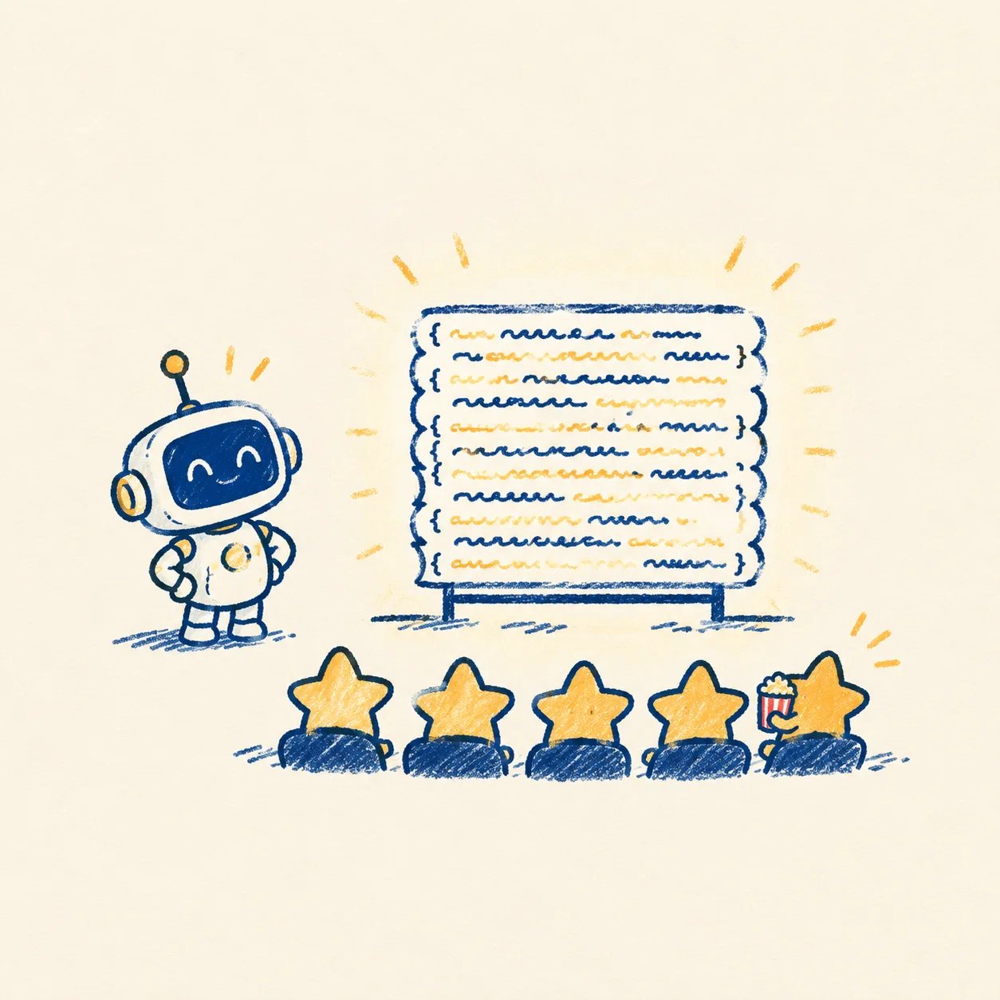

# 让 Agent 画动画 · 代码动画实操手记

这一页里所有动的东西——自绘的笔迹、呼吸的星野、排序的柱子、生长的折线——都不是录屏、不是 GIF：它们是一个 Agent 写的代码，此刻正在你的屏幕上活着跑。

**[打开这一页 →](https://starrysea1412.github.io/agent-code-animation/)**

五个可玩 demo（手写笔触 / 呼吸的星野 / 排序竞速 / 数据生长 / 重力与风）+ 可以直接抄的指令模板 + 一套截帧验收法。

> 文中提及：[Remotion](https://www.remotion.dev/) · [Motion Canvas](https://motioncanvas.io/) · [3dviz-pro-max](https://github.com/viettranx/3dviz-pro-max) · [machine-skill](https://github.com/airsuphq/machine-skill)。

---

单页站点由 `index.html` 单文件承载（零构建、零依赖）：全部动画为原生 SVG / Canvas / CSS 实现，插图位于 `assets/`。
